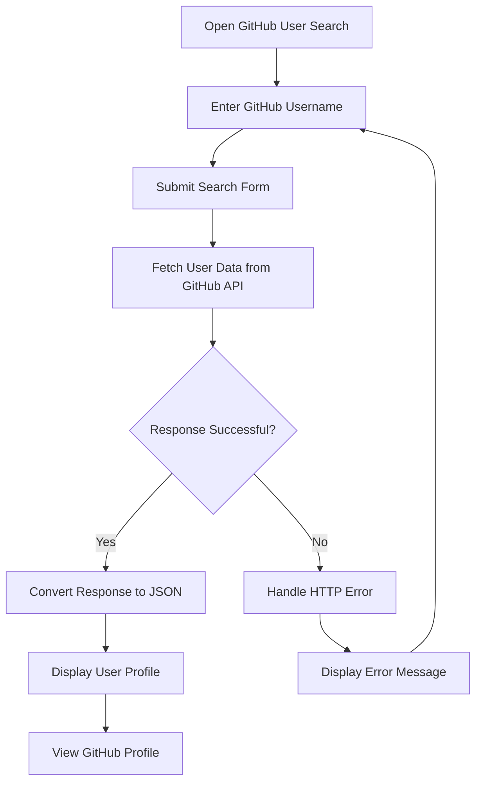

# 🔎 GitHub User Search

⚡ **GitHub User Search** is a simple and interactive web application built using **HTML5, CSS3, and JavaScript**.

It allows users to search for GitHub profiles by username and displays profile details such as profile picture, name, bio, public repositories, followers, and following using the GitHub REST API.

This project demonstrates JavaScript concepts such as **Fetch API, Promises, async/await, JSON parsing, error handling, DOM manipulation, event handling, functions, and template literals**.

<p align="center">
  
  
  
  
</p>

---

## 🚀 Technologies Used

- HTML5
- CSS3
- JavaScript
- Fetch API
- GitHub REST API

---

## ⚙️ Key Features

- 🔎 Search GitHub users by username
- 👤 Display profile picture and username
- 📝 Display the user's name and bio
- 📦 Show the number of public repositories
- 👥 Display followers and following counts
- 🔗 Open the user's GitHub profile
- ⏳ Display a loading message while fetching data
- ⚠️ Handle invalid usernames and API errors
- 📱 Responsive user interface for different screen sizes

---

## 🧠 JavaScript Concepts Practiced

- Fetch API and HTTP Requests
- Promises and Async/Await
- JSON Parsing using `response.json()`
- Error Handling using `try...catch`
- HTTP Status Checking using `response.ok`
- DOM Manipulation
- Event Handling using `addEventListener()`
- Functions and Arrow Functions
- Conditional Statements
- Template Literals
- String Methods: `trim()` and `encodeURIComponent()`
- Input Validation
- Dynamic HTML Rendering

---

## 📁 Project Structure

```text
GitHub User Search/
├── index.html
├── style.css
├── script.js
└── README.md
```

---

## 🔁 How It Works



---

## 🌐 API Used

This project uses the GitHub REST API to retrieve public user profile information.

**API Endpoint:**

```text
https://api.github.com/users/{username}
```

**Example:**

```text
https://api.github.com/users/octocat
```

The API returns JSON data containing information such as the user's login, avatar URL, bio, public repositories, followers, following, and profile URL.

---

## 🚀 How to Run

1. Clone the repository:

   ```bash
   git clone https://github.com/VarshaChintapatla/Javascript.git
   ```

2. Open the repository in VS Code.
3. Navigate to the `GitHub User Search` folder.
4. Make sure `index.html`, `style.css`, and `script.js` are in the same folder.
5. Open `index.html` in your browser or use the VS Code Live Server extension.
6. Enter a GitHub username and click **Search** to view the profile.

---

## ⚠️ Notes

- An active internet connection is required to fetch GitHub profile information.
- The application displays publicly available profile data.
- Unauthenticated GitHub API requests are subject to rate limits.
- No API key is required for this basic public profile search.

---

## 🔮 Future Improvements

- 💾 Save recent searches using `localStorage`.
- 🔍 Add search history and suggestions.
- 📚 Display the user's public repositories.
- ⭐ Show repository stars and programming languages.
- 🌙 Add dark and light themes.
- 📄 Add pagination for repository results.
- 🔐 Integrate authenticated GitHub API access for additional features.

---

## 🔗 Connect With Me

[GitHub](https://github.com/VarshaChintapatla) | [LinkedIn](https://www.linkedin.com/in/varsha-chintapatla-391428332/)

---

<p align="center">
  Made with ❤️ by <strong>Chintapatla Varsha</strong>
</p>
