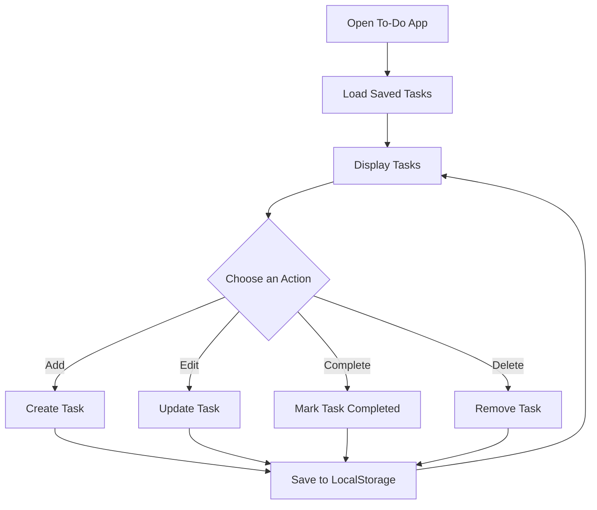

# 📝 To-Do App

⚡ **To-Do App** is a simple and interactive task management application built using **HTML5, CSS3, and JavaScript**.

It allows users to add, view, edit, complete, and delete tasks. Tasks are stored in the browser using `localStorage`, so they remain available even after refreshing the page.

This project demonstrates JavaScript fundamentals such as **CRUD operations, arrays, objects, DOM manipulation, event handling, functions, and localStorage**.

<p align="center">
  
  
  
</p>

---

## 🚀 Technologies Used

- HTML5
- CSS3
- JavaScript
- Browser LocalStorage

---

## ⚙️ Key Features

- ➕ Add new tasks
- 📋 Display all tasks
- ✏️ Edit existing tasks
- ✅ Mark tasks as completed
- 🗑️ Delete tasks
- 💾 Save tasks using `localStorage`
- 🔄 Restore tasks after refreshing the page
- 🎨 Simple and interactive user interface

---

## 🧠 JavaScript Concepts Practiced

- CRUD Operations (Create, Read, Update, Delete)
- Arrays and Objects
- Array Methods: `push()`, `forEach()`, and `splice()`
- DOM Manipulation
- Event Handling using `addEventListener()`
- Functions
- Conditional Statements
- Browser `localStorage`
- JSON Methods: `JSON.stringify()` and `JSON.parse()`

---

## 📁 Project Structure

```text
To-Do-App/
├── index.html
├── style.css
├── script.js
└── README.md
```

---

## 🔁 How It Works



---

## 🚀 How to Run

1. Clone the repository:

   ```bash
   git clone <your-github-repository-url>
   ```

2. Open the project folder in VS Code.
3. Make sure `index.html`, `style.css`, and `script.js` are in the same folder.
4. Open `index.html` in your browser or use VS Code Live Server.

---

## 🔮 Future Improvements

- Add task categories and priorities.
- Add due dates and reminders.
- Add filters for all, completed, and pending tasks.
- Add a search feature.
- Add a dark mode.
- Improve the user interface for mobile devices.

---

## 🔗 Connect With Me

[GitHub](https://github.com/VarshaChintapatla) | [LinkedIn](https://www.linkedin.com/in/varsha-chintapatla-391428332/)

---

<p align="center">
  Made with ❤️ by <strong>Chintapatla Varsha</strong>
</p>