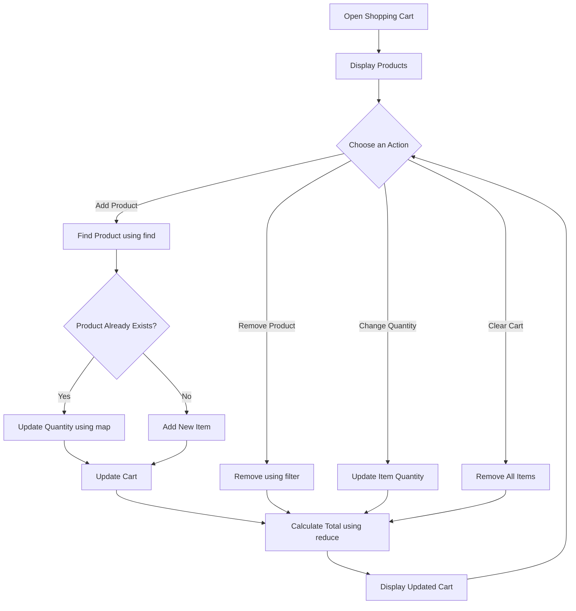

# 🛒 Shopping Cart

⚡ **Shopping Cart** is a simple and interactive shopping application built using **HTML5, CSS3, and JavaScript**.

It allows users to browse products, add items to the cart, increase or decrease quantities, remove products, and calculate the total price dynamically.

This project demonstrates JavaScript fundamentals such as **CRUD operations, arrays, objects, array methods, DOM manipulation, event handling, functions, and event delegation**.

<p align="center">
  
  
  
</p>

---

## 🚀 Technologies Used

- HTML5
- CSS3
- JavaScript

---

## ⚙️ Key Features

- 🛍️ Display products with names, icons, and prices
- ➕ Add products to the shopping cart
- 🔢 Increase or decrease product quantities
- ✏️ Update quantities dynamically
- 🗑️ Remove individual products from the cart
- 🧹 Clear all items from the cart
- 💰 Calculate the total price automatically
- ✅ Display a demo checkout confirmation
- 🎨 Simple and responsive user interface

---

## 🧠 JavaScript Concepts Practiced

- CRUD Operations (Create, Read, Update, Delete)
- Arrays and Objects
- Array Methods: `map()`, `filter()`, `reduce()`, `find()`, and `push()`
- DOM Manipulation
- Event Handling using `addEventListener()`
- Event Delegation
- Functions and Arrow Functions
- Conditional Statements
- Template Literals
- Spread Syntax (`...`)
- Dynamic HTML Rendering
- Number Formatting using `toLocaleString()`

---

## 📁 Project Structure

```text
Shopping Cart/
├── index.html
├── style.css
├── script.js
└── README.md
```

---

## 🔁 How It Works



---

## 🚀 How to Run

1. Clone the repository:

   ```bash
   git clone https://github.com/VarshaChintapatla/Javascript.git
   ```

2. Open the repository in VS Code.
3. Navigate to the `Shopping Cart` folder.
4. Make sure `index.html`, `style.css`, and `script.js` are in the same folder.
5. Open `index.html` in your browser or use the VS Code Live Server extension.

---

## 🔮 Future Improvements

- Save cart items using `localStorage`.
- Add product search and category filters.
- Display actual product images.
- Add a wishlist feature.
- Implement user authentication.
- Integrate a backend and database to manage products and orders.
- Add a checkout page with delivery address details.
- Integrate a payment gateway for real transactions.

---

## 🔗 Connect With Me

[GitHub](https://github.com/VarshaChintapatla) | [LinkedIn](https://www.linkedin.com/in/varsha-chintapatla-391428332/)

---

<p align="center">
  Made with ❤️ by <strong>Chintapatla Varsha</strong>
</p>